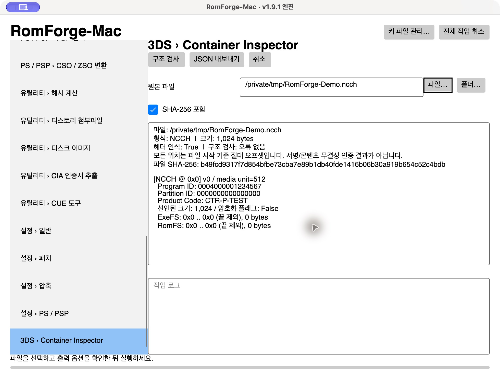

# RomForge-Mac 1.9.1-mac.1

RomForge **v1.9.1**의 변환·패치 엔진과 ViewModel을 macOS에 연결한 비공식 포트입니다. Windows WPF 화면은 Avalonia 화면으로 대체했습니다. v0.7의 읽기 전용 3DS Container Inspector도 포함합니다. 원본의 모양을 그대로 복제한 버전은 아닙니다.

기준: https://github.com/sinjunyoung/RomForge/releases/tag/v1.9.1  
소스 커밋: `1da80db6d558f0be95509393f3099fd189708319`

## 다운로드

[최신 릴리스와 실행 ZIP](https://github.com/Neotrendset/Neotrendset/releases/tag/v1.9.1-mac.1)에서 Apple Silicon용 앱, 검증에 사용한 소스 ZIP, SHA-256 체크섬과 사용법을 받을 수 있습니다.



## 실행

- **Apple Silicon Mac / macOS 15 이상**. Intel Mac용 실행 파일은 포함하지 않습니다.
- 실행 ZIP을 풀고 `RomForge-Mac.app`을 실행하세요. .NET을 따로 설치하지 않아도 됩니다.
- 개발용 ad-hoc 서명이며 Apple Developer ID 서명·공증은 없습니다.
- 왼쪽에서 기능을 선택하고 입력 파일·출력 옵션을 지정한 뒤 실행합니다. 목록 항목을 선택하면 아래의 **선택 항목 편집**을 펼쳐 세부 정보와 패치 경로를 수정할 수 있습니다.
- 입력 칸은 파일·폴더 선택과 Finder 드래그를 지원합니다. 파일 목록의 폴더 추가는 내부 파일을 확장하여 가져옵니다.
- Switch 리팩에서 파일을 추가하면 언어별 제목·배급사·아이콘 정보를 읽습니다. 언어 목록의 항목을 선택해 편집하세요. 일반 패치는 연속 패치 목록의 파일 칸을 편집하거나 선택 항목의 파일 선택 버튼을 사용합니다.
- 외장 디스크 쓰기는 선택한 디스크를 지웁니다. 원본과 동일하게 확인 대화상자를 표시합니다. macOS 원시 디스크 접근에는 관리자 권한이 필요하며 실제 장치 쓰기는 이번 검증에 포함하지 않았습니다.

## 키·설정·출력

설정과 기본 출력 폴더는 `~/Library/Application Support/RomForge-Mac`입니다. 필요한 키는 사용자가 가진 파일을 **키 파일 관리…**에서 가져옵니다. 키 파일을 내려받거나 동봉하지 않습니다.

키 폴더: `~/Library/Application Support/RomForge-Mac/keys`  
지원 이름: `prod.keys`, `title.keys`, `boot9.bin`, `aes_keys.txt`, `seeddb.bin`, `certs.bin`, `keys.txt`.

3DS SD 작업에는 해당 SD의 `movable.sed` 등 원본과 같은 입력이 필요합니다. 외장 디스크 작업 외의 일반 파일 작업은 관리자 권한 없이 사용합니다. 대용량 작업 전에 출력 공간을 확인하세요.

환경 변수: `ROMFORGE_DATA_DIR`(설정·기본 출력), `ROMFORGE_KEYS_DIR`(키), `ROMFORGE_NATIVE_DIR`(네이티브 도구). 자동 검사는 `ROMFORGE_TEST_MODE=1`에서 실제 디스크 검색을 생략합니다.

## 포함 기능과 검증

기능 화면 31개와 원본 엔진을 연결했습니다. 상세 범위는 [기능표](port/FEATURES.md), 수행한 검사는 [검증 보고서](port/VALIDATION.md)를 보세요. 사용자 키가 필요한 상용 게임의 전체 재패킹·SD 설치·실제 외장 디스크 쓰기까지 성공했다고 주장하지 않습니다.

## 소스 빌드

macOS 15 이상 Apple Silicon, .NET SDK 8, Xcode Command Line Tools가 필요합니다.

```sh
dotnet restore RomForge.Mac/RomForge.Mac.csproj
dotnet build RomForge.Mac.sln -c Release --disable-build-servers -p:UseSharedCompilation=false -m:1
./port/scripts/test.sh
./port/scripts/publish-mac.sh ./artifacts
```

동봉한 `port/native/osx-arm64`에는 macOS용 CHD·xdelta3·libdeflate 및 종속 라이브러리가 들어 있습니다. 원본 Windows 네이티브 DLL을 Mac 앱에 복사하지 않습니다. 빌드 시 소스를 줄이는 trimming과 single-file 게시를 사용하지 않습니다.

네이티브 도구의 출처·버전·해시는 `port/native-provenance.json`, 라이선스는 `port/licenses`, 이식 내역과 재빌드 참고는 [이식 문서](port/PORTING.md)에 있습니다. 원본의 문서·저작권 표기·LICENSE를 유지했습니다. 원본 README는 `README.upstream.md`, 공식 사용법은 https://sinjunyoung.github.io/RomForge/ 입니다.
